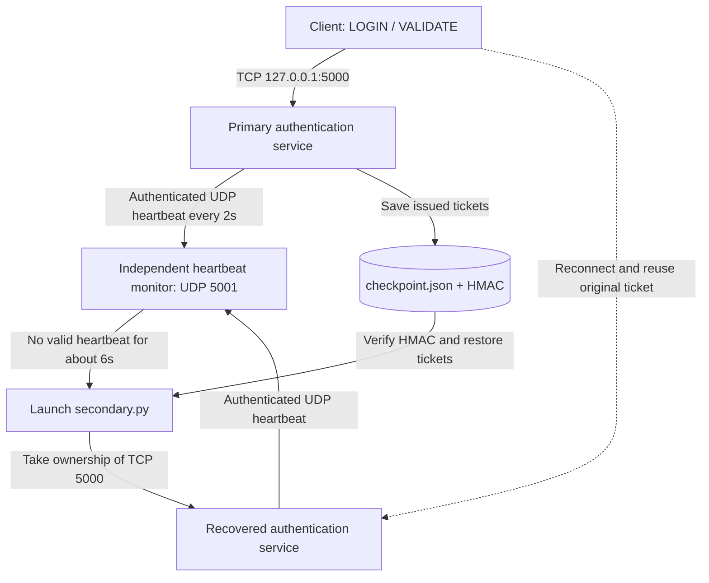

# CS 456 — Resilient Security Systems
## Mini Group Project 1: Failure Detection and Recovery

**Course:** CS 456 — Modern Cybersecurity  
**Colorado State University**  
**Instructor:** Viktoria Koscinski  
**Project:** Part 1 — Failure Detection and Adversarial Monitoring; Part 2 — Recovery and Adversarial Assessment

### Team Members
- Jason Arthur
- Kjell Falk
- Myla Vencill
- Soumyabrata Ghosh

---

## 1. Project Overview

How do we know that an authentication service is actually running? What if an attacker can make a failed service look healthy? And once the service really crashes, how do we bring it back **without invalidating a ticket that was already issued**?

We built a local TCP authentication and ticket service, a separate UDP heartbeat monitor, and a client that logs in and repeatedly validates the same ticket. The work has two parts:

- **Part 1 — Failure detection and heartbeat security.** Compare a plaintext heartbeat against HMAC-authenticated heartbeats. Test forged messages and replayed messages to understand what the monitor can and cannot trust.
- **Part 2 — Passive recovery and adversarial testing.** Save issued tickets in an authenticated checkpoint, launch a secondary server automatically when the monitor detects a failure, and reconnect the client with the **same pre-crash ticket**. Then test two attacks against recovery itself: false failover and checkpoint tampering.

The current implementation runs on one machine using `127.0.0.1`. It is a course demonstration, **not a production authentication or distributed high-availability system**.

### What the implementation demonstrates

- An independent monitor detects a missing heartbeat after approximately six seconds under the default configuration.
- In secure mode, an HMAC and sequence/timestamp checks reject the specific spoofing and replay attacks we tested.
- The primary persists ticket state before confirming a successful login.
- After a primary crash, the monitor starts a secondary that restores the most recent valid checkpoint.
- The client reconnects automatically and attempts to validate its original ticket.
- A false failover cannot start a second listener on the **same local TCP address and port** while the primary is still serving.
- If the checkpoint fails its HMAC integrity check, the secondary refuses to restore its tickets.

---

## 2. Project Files

| File | Purpose |
|------|---------|
| `auth_service.py` | Primary TCP authentication service, simulated crashes, heartbeat sender, ticket checkpoint writes; also provides the shared server logic for recovery. |
| `client.py` | Issues one login ticket, repeatedly validates it, reconnects after a failure, and reuses the same ticket. |
| `heartbeat_monitor.py` | Independent UDP monitor with baseline/secure modes; detects outages, logs events, and launches the secondary by default. |
| `secondary.py` | Promoted passive standby; loads checkpointed ticket state, attempts exclusive ownership of TCP port 5000, then sends its own heartbeats. |
| `checkpoint.py` | Atomic JSON checkpoint persistence, HMAC signing and verification, and fail-closed recovery on corrupt state. |
| `protocol.py` | Plaintext and HMAC-SHA256 heartbeat formats, generation, and validation. |
| `config.py` | Shared addresses, ports, timeout values, keys, checkpoint path, and standby launch configuration. |
| `audit_script.py` | Part 1 heartbeat spoofing/replay, plus Part 2 heartbeat-dropping and checkpoint-tampering attacks. |
| `quick_test.py` | Automated end-to-end checks for crash recovery, checkpoint tampering, and false failover. |
| `CONTRIBUTIONS.md` | Team roles and the recorded contributions for both parts. |
| `README.md` | Setup, architecture, commands, test observations, and limitations. |

Runtime-generated files include `checkpoint.json`, `incidents.log`, `standby.log`, and files under `test_logs/`. They are test artifacts, **not source code**.

---

## 3. Architecture and Recovery Design

### Main components



### Why passive redundancy?

We chose **passive redundancy**: only one authentication service should serve requests at a time. The secondary process is not an active second TCP server. Instead, the monitor launches it when the primary appears to have failed. The secondary restores the saved state before it starts accepting requests.

This is simpler to demonstrate than running two independent active replicas and synchronizing every request. It also has a tradeoff: recovery requires detection time plus process start-up and reconnection, so it is **not zero-downtime**.

### What happens during a normal login?

1. The client sends `LOGIN` to TCP port `5000` with the demonstration credentials.
2. The primary issues a random session ticket and adds it to its in-memory ticket dictionary.
3. `checkpoint.py` saves the ticket dictionary to `checkpoint.json` using a temporary file, flush-and-sync, and atomic replacement.
4. A separate HMAC-SHA256 authenticates the checkpoint contents. The server acknowledges login only after the checkpoint save succeeds.
5. Later `VALIDATE` requests check that the ticket exists in the current server's ticket dictionary.

### What happens during recovery?

1. The primary stops sending valid heartbeats after a crash.
2. The monitor detects a timeout and logs `[Crash Detected]`.
3. The monitor launches `secondary.py` and logs `[Failover Triggered]`.
4. The secondary verifies `checkpoint.json`. A valid checkpoint restores the ticket dictionary; a corrupted or tampered checkpoint is rejected and restores **no tickets**.
5. The secondary binds to TCP `127.0.0.1:5000`. Only after obtaining that port does it start sending heartbeats.
6. The monitor receives a heartbeat from `node=secondary` and logs `[Service Restored]`.
7. The client reconnects and validates the **same** ticket issued before the crash.

**Important scope:** Using one TCP port prevents two local listeners in our experiment. It is **not** a general split-brain solution for two hosts or a partitioned distributed system.

---

## 4. Configuration

| Setting | Default | Purpose |
|---------|---------|---------|
| Host | `127.0.0.1` | All services run on localhost. |
| Authentication server | TCP `5000` | Client login and ticket validation. |
| Heartbeat monitor | UDP `5001` | Normal heartbeat receiver. |
| Replay / false-failover monitor | UDP `5002` | Allows attack relay to receive on 5001 and forward to a separate monitor. |
| Heartbeat interval `T` | 2 seconds | Period between heartbeat messages. |
| Missed-beat threshold `N` | 3 | Number of missed intervals allowed. |
| Outage window `W = T × N` | About 6 seconds | Monitor's detection threshold. |
| Maximum clock skew | 2 seconds | Timestamp freshness check in secure mode. |
| Default primary crash probability | **5% per request** | Simulated hard crash via `os._exit(1)`; adjustable using `CRASH_PROBABILITY`. |
| Standby crash probability | `0` | Standby does not inject random failures. |
| Checkpoint file | `checkpoint.json` | Saved session tickets. |
| Monitor log | `incidents.log` | State changes and failover events. |
| Standby log | `standby.log` | Secondary process output. |

To change the simulated primary crash probability in **PowerShell** before starting the primary:

```powershell
$env:CRASH_PROBABILITY = "0.15"  # 15% for a shorter random-crash demonstration
python .\auth_service.py --secure
```

Use `"0"` for deterministic adversarial tests where the primary must remain alive until deliberately terminated. A new PowerShell session does not necessarily inherit the variable set in another window.

The heartbeat secret can be set with `HB_SECRET` and the **separate** checkpoint secret with `CKPT_SECRET`. All processes taking part in the same experiment must use consistent values. The built-in keys and login credentials are demonstrations only; never treat them as production secrets.

---

## 5. Heartbeat Communication

### Baseline mode

The server sends the plaintext value:

```text
HEARTBEAT
```

The baseline monitor recognizes this value but does not authenticate its sender. Another local process can impersonate a healthy service by transmitting the same message.

### Secure mode

The secure heartbeat format is:

```text
HEARTBEAT|node_id|boot_id|seq|timestamp|hmac
```

- `node_id`: Identifies the primary or secondary service.
- `boot_id`: Random identifier for a service instance.
- `seq`: Increasing sequence number within a service instance.
- `timestamp`: Sending time, checked for freshness.
- `hmac`: HMAC-SHA256 over the message fields using the shared heartbeat secret.

The monitor checks the format, HMAC, timestamp, and sequence number before accepting a beat. An unsigned plaintext message fails secure-mode validation; replaying a previously accepted signed beat also fails the sequence check.

Checkpoint integrity uses a **different HMAC secret** from heartbeat authentication. Neither HMAC encrypts the data or prevents a malicious process that possesses the key from generating a valid signature.

---

## 6. Requirements and Installation

### Requirements

- Python 3 (manually verified on Windows with **Python 3.12.10**)
- Git
- PowerShell, Terminal, or another command shell
- Windows, Linux, or macOS capable of running Python and localhost TCP/UDP sockets

All runtime modules use Python's standard library. No third-party `pip install` step is required.

### Clone the current team repository

```powershell
git clone https://github.com/kjellfalk/CS-456-Group-Mini-Project.git
cd .\CS-456-Group-Mini-Project
```

For an existing local clone:

```powershell
git switch main
git pull --ff-only
```

Run each long-running service in its **own terminal**, from the repository root. Keep port `5000` available for the authentication server, and stop previous monitors or attack scripts before reusing UDP `5001` or `5002`.

> Windows note: If `Ctrl+C` does not terminate the primary, inspect the Python process command line and stop **only** the matching `auth_service.py` PID. A blanket `Stop-Process python` command may kill unrelated work.

---

## 7. Running the Baseline System

### Step 1 — Start the Heartbeat Monitor

Open Terminal 1:

```powershell
python .\heartbeat_monitor.py --no-failover
```

The monitor starts listening for UDP heartbeats on port `5001`.

Initially, its status is `WAITING`.

### Step 2 — Start the Authentication Server

Open Terminal 2:

```powershell
python .\auth_service.py
```

The server begins listening for TCP connections and sending periodic heartbeat messages.

The monitor changes its status to `UP` after receiving the first valid heartbeat. This example uses `--no-failover` to reproduce the original Part 1 detection behavior.

### Step 3 — Run the Client

Open Terminal 3:

```powershell
python .\client.py
```

The client attempts to log in and validates the resulting ticket.

Each incoming request has a **5% default probability** of triggering the server's simulated crash. Set `CRASH_PROBABILITY` in the primary's PowerShell session if a different probability is wanted.

When the server crashes, the client loses its connection. With `--no-failover`, the monitor reports the failure without launching a standby. The client may continue retrying, but recovery is intentionally disabled for this Part 1 demonstration.

If no further valid heartbeat arrives, the monitor reports the outage after approximately six seconds.

---

## 8. Adversarial Audit: Heartbeat Spoofing

### What Is Heartbeat Spoofing?

Heartbeat spoofing happens when an attacker sends fake heartbeat messages to make a monitoring system believe that a service is still functioning.

Our baseline monitor only checks whether it receives the expected plaintext heartbeat.

It does not authenticate the sender.

We wanted to test whether this weakness could be used to conceal an actual server failure.

### Running the Spoofing Attack

Start the baseline monitor:

```powershell
python .\heartbeat_monitor.py --no-failover
```

Start the authentication server in another terminal:

```powershell
python .\auth_service.py
```

Start the adversarial audit script in a third terminal:

```powershell
python .\audit_script.py --mode spoof --duration 300 --interval 1
```

The arguments mean:

- `--mode spoof`: Run the heartbeat spoofing attack.
- `--duration 300`: Continue sending messages for 300 seconds.
- `--interval 1`: Send a fake heartbeat every second.

Next, run the client in another terminal:

```powershell
python .\client.py
```

The client sends requests until the server encounters its simulated random crash. With the default 5% probability, the number of requests before a crash varies.

### What We Observed

The baseline monitor continued accepting the fake heartbeats even after the authentication server had crashed.

As long as the attacker continued sending messages, the monitor remained in the `UP` state.

After the attack stopped, the monitor finally detected that no valid heartbeat messages were arriving.

In one experiment, the monitor reported the outage **6.09 seconds after the last accepted fake heartbeat**.

We also repeated the experiment by manually terminating the authentication service. The monitor continued accepting the attacker's messages and reported the failure only after the fake messages stopped.

### Finding

The baseline monitor could not distinguish a genuine heartbeat from an attacker-generated heartbeat.

An attacker could therefore conceal an actual service failure simply by continuing to send the expected plaintext message.

---

## 9. Testing Spoofing Against Secure Monitoring

We repeated the same attack using authenticated heartbeat messages.

### Step 1 — Start the Secure Monitor

```powershell
python .\heartbeat_monitor.py --secure --no-failover
```

### Step 2 — Start the Secure Authentication Server

```powershell
python .\auth_service.py --secure
```

### Step 3 — Run the Spoofing Attack

```powershell
python .\audit_script.py --mode spoof --duration 600 --interval 1
```

### Step 4 — Trigger the Simulated Crash

```powershell
python .\client.py
```

### What We Observed

The secure monitor accepted genuine signed heartbeats from the authentication server.

However, the fake plaintext heartbeats sent by our audit script were rejected as malformed messages.

When the authentication server crashed, the monitor detected the outage even though the attacker was still sending fake messages.

In our experiment, the secure monitor reported:

`SERVICE DOWN: no valid heartbeat for 6.28s`

The attacker continued sending messages after this alert, and the monitor continued rejecting them.

### Finding

Unlike the baseline monitor, the secure monitor did not treat the attacker-generated plaintext heartbeats as valid evidence that the service was running.

The attack failed to conceal the server crash.

---

## 10. Adversarial Audit: Replay Attack

### What Is a Replay Attack?

A replay attack involves capturing a legitimate message and sending it again.

Unlike basic spoofing, the attacker does not necessarily need to create a new message or forge a signature.

Instead, the attacker attempts to reuse a message that was already valid.

For our experiment, we wanted to see whether the monitor would accept the same signed heartbeat more than once.

### How We Tested It

Our audit script temporarily acts as an intermediary between the authentication service and the heartbeat monitor.

The authentication service sends its secure heartbeats to UDP port `5001`.

Our audit script listens on this port, captures the original message, and forwards it unchanged to the secure monitor on port `5002`.

The script then sends an identical copy of that same heartbeat.

### Step 1 — Start the Secure Monitor on Port 5002

```powershell
python .\heartbeat_monitor.py --secure --port 5002 --no-failover
```

### Step 2 — Start the Replay Audit Script

```powershell
python .\audit_script.py --mode replay --duration 120 --monitor-port 5002
```

### Step 3 — Start the Secure Authentication Server

```powershell
python .\auth_service.py --secure
```

**Note:** Start the replay script before starting the authentication server. The script needs to listen on port `5001` to capture the genuine heartbeats.

### What We Observed

The secure monitor accepted each original signed heartbeat.

However, when the audit script immediately sent an identical copy, the monitor rejected it.

For example, the monitor accepted a heartbeat with sequence number `35`.

When the same signed message was sent again, the monitor reported:

`REJECTED: replayed/out-of-order seq=35 (last=35)`

This happened consistently during our experiment.

### Finding

A valid signature alone does not mean a heartbeat is new.

The monitor's sequence-number checks prevented the repeated messages from being accepted as fresh heartbeats.

The timestamp validation also provides an additional check against stale messages.

---

## 11. Part 2: Demonstrating Automatic Recovery

### Normal recovery, with the same ticket

The following commands are for **Windows PowerShell**. Open three terminals in the project folder. First, ensure no earlier service or monitor is running.

**Terminal 1 — secure heartbeat monitor with automatic failover:**

```powershell
python .\heartbeat_monitor.py --secure
```

**Terminal 2 — primary server with a controlled chance of crashing:**

```powershell
$env:CRASH_PROBABILITY = "0.15"
python .\auth_service.py --secure
```

**Terminal 3 — login and repeated validation:**

```powershell
python .\client.py
```

The client prints a ticket and continuously validates it. A simulated primary crash eventually ends its connection; the monitor detects the silence and launches the standby, and the client reconnects. The decisive client evidence is:

```text
[CLIENT] connection lost; waiting for automated recovery...
[PASS] SAME pre-crash ticket accepted by recovered secondary
```

The monitor records the sequence:

```text
[Crash Detected] ...
[Failover Triggered] ...
[Service Restored] ...
```

The secondary's startup and restored ticket count are recorded in `standby.log`. Actual timing varies across runs. In one manual Windows run, the timeout alert occurred after approximately **6.08 seconds** without a valid heartbeat, and the recovered heartbeat arrived roughly **0.24 seconds** after the failover trigger. The client also reported a successful reconnect and validation of its original ticket.

**Optional deterministic crash:** Set `$env:CRASH_PROBABILITY = "0"` in Terminal 2 before starting the service. After the client has logged in, locate the `auth_service.py` process in a separate PowerShell window:

```powershell
Get-CimInstance Win32_Process |
Where-Object { $_.Name -match "python" -and $_.CommandLine -match "auth_service\.py" } |
Format-List ProcessId,CommandLine
```

After confirming the correct PID, terminate **that process only**:

```powershell
Stop-Process -Id YOUR_PID -Force
```

Replace `YOUR_PID` with the actual number (without angle brackets). Do **not** stop the monitor. The same recovery sequence should follow. This simulated hard stop is useful when recording the demonstration video.

### What counts as successful recovery?

A successful run must show **all three** facts, not just the standby starting:

1. The primary issued a ticket and checkpointed it before the crash.
2. The monitor detected missing heartbeats and started a secondary that restored valid checkpoint state.
3. The **original** ticket was accepted by the recovered secondary after the client's reconnection.

---

## 12. Part 2 Adversarial Assessment — False Failover

**Question:** Can missing heartbeats cause a takeover attempt even when the primary is still serving requests?

This attack uses an intermediary UDP relay. The primary sends heartbeats to UDP `5001`. The relay forwards valid beats to a secure monitor on UDP `5002`, then deliberately drops them for nine seconds while the primary continues listening on TCP `5000`.

### Run the experiment

Stop earlier monitor, primary, secondary, and attack processes before starting this test.

**Terminal 1 — secure monitor on 5002:**

```powershell
python .\heartbeat_monitor.py --secure --port 5002
```

**Terminal 2 — heartbeat relay:**

```powershell
python .\audit_script.py --mode false-failover --monitor-port 5002 --forward-seconds 5 --drop-seconds 9 --resume-seconds 5
```

**Terminal 3 — primary with crashes disabled:**

```powershell
$env:CRASH_PROBABILITY = "0"
python .\auth_service.py --secure
```

Start the relay **before** starting the primary so it can bind UDP `5001`. The attack script proves the primary is still active by attempting a TCP login during the heartbeat blackout.

### Expected evidence

The relay reports:

```text
[DROP] primary heartbeat discarded ...
[PRIMARY STILL SERVING] TCP login succeeded while heartbeats are blocked
```

The monitor may report `[Crash Detected]` and `[Failover Triggered]` even though the primary has not crashed. Check the secondary's output:

```powershell
Get-Content .\standby.log -Tail 30
```

Our Windows experiment produced:

```text
[SPLIT-BRAIN BLOCKED] Cannot take primary port 5000: [WinError 10048] ...
```

**Finding:** The monitor **can** be fooled into a false failure decision by lost heartbeats. The competing secondary cannot bind the already occupied local service port, so the tested single-host setup does not allow two processes to serve from the same `127.0.0.1:5000` endpoint. This is a limited local safeguard, **not a distributed consensus or fencing mechanism**. If the relay exits while the primary keeps sending to UDP 5001, the monitor on UDP 5002 may detect another outage until the system is reset.

---

## 13. Part 2 Adversarial Assessment — Checkpoint Tampering

**Question:** What happens if the saved ticket data is modified before the standby restores it?

The checkpoint contains an HMAC over the saved ticket state. For this test, we deliberately add a forged ticket **without recomputing the HMAC**, then crash the primary. The standby must detect the mismatch, discard the untrusted checkpoint, and reject both the old and forged ticket rather than treating the modified contents as valid.

### Run the experiment

Stop previous services, then use the project root in four terminals.

**Terminal 1 — monitor:**

```powershell
python .\heartbeat_monitor.py --secure
```

**Terminal 2 — primary with random crashes disabled:**

```powershell
$env:CRASH_PROBABILITY = "0"
python .\auth_service.py --secure
```

**Terminal 3 — client:**

```powershell
python .\client.py
```

Wait for `[CLIENT] TICKET ISSUED` and `[CHECKPOINT] saved 1 tickets to checkpoint.json`, then stop **only the client**. Keep the primary and monitor running.

**Terminal 4 — edit the checkpoint in the controlled local test:**

```powershell
python .\audit_script.py --mode tamper-checkpoint --tamper-kind forge
```

Now terminate the primary from Terminal 2 or by its verified PID, as described in Section 11. **Do not issue another login after tampering**, because another legitimate checkpoint save could overwrite the modified file. Keep the monitor running so it launches the standby.

Check the result:

```powershell
Get-Content .\standby.log -Tail 30
```

Our manual test produced:

```text
[CHECKPOINT] REJECTED (HMAC mismatch (tampering detected); starting with no tickets)
[ALERT] Checkpoint integrity failed; refusing all old tickets
[SERVICE] secondary listening on tcp://127.0.0.1:5000
```

**Finding:** The secondary continues operating but starts with **no restored tickets**. This is a deliberate fail-closed response: existing sessions are lost because the checkpoint cannot be trusted. The automated test also directly verifies that both the original ticket and the added forged ticket are rejected.

The audit tool additionally supports `--tamper-kind corrupt`, `truncate`, and `delete`. A deleted checkpoint is treated as **missing**, causing an empty state; it is not the same detection result as an HMAC mismatch.

---

## 14. Automated End-to-End Verification

The repository includes `quick_test.py`, which runs the three Part 2 checks against local services. Run it **only after terminating any manual monitor, server, client, or attack processes**, since the tests use TCP `5000` and UDP `5001`/`5002`.

```powershell
python -m py_compile .\auth_service.py .\client.py .\heartbeat_monitor.py .\checkpoint.py .\secondary.py .\audit_script.py .\quick_test.py
python .\quick_test.py
```

The merged GitHub `main` branch was verified on Windows with Python 3.12.10, producing:

```text
TEST 1: primary crash -> standby recovery -> same ticket valid
PASS: pre-crash ticket accepted after automatic failover
TEST 2: forged checkpoint -> fail closed on failover
PASS: checkpoint tampering detected; old and forged tickets rejected
TEST 3: dropped heartbeats -> false failover -> no double primary
PASS: original primary remained alive; competing secondary rejected port
ALL 3 INTEGRATION TESTS PASSED
```

The script starts and stops its own test processes, checks responses and monitor logs, and writes diagnostic output under `test_logs/`. It may replace local test artifacts such as `checkpoint.json`, `incidents.log`, and `standby.log`; **do not run it while preserving an unrelated live session or before copying important evidence**.

---

## 15. Experimental Results

### Part 1 — heartbeat detection and message security

| Experiment | Observation | Result |
|------------|-------------|--------|
| Normal heartbeat monitoring | Genuine beats change monitor state to `UP`. | Passed |
| Primary crash | The independent monitor reports an outage after roughly six seconds without valid beats. | Passed |
| Baseline spoofing | Unsigned fake messages kept the monitor reporting `UP` after the real server stopped. | Attack succeeded |
| Secure spoofing | The monitor rejected unsigned heartbeat messages; the outage was detected. | Attack rejected |
| Secure replay | Duplicate signed heartbeats were rejected as replayed/out of order. | Attack rejected |

The original Part 1 experiments recorded an outage after **6.09 seconds** following the last accepted spoofed heartbeat and **6.28 seconds** in the secure-spoofing test. These are run-specific measurements, not guaranteed service-level objectives.

### Part 2 — recovery and attacks on recovery

| Experiment | What was checked | Result |
|------------|------------------|--------|
| Normal recovery | Primary crash, automatic secondary promotion, checkpoint restoration. | Passed |
| Ticket continuity | Original pre-crash ticket accepted after client reconnects. | Passed |
| False failover | Dropping beats triggers a takeover attempt even while the primary answers TCP requests. | False alarm reproduced |
| Local competing listener | Secondary exits instead of taking TCP port 5000 already held by the primary. | Passed in single-host setup |
| Checkpoint tampering | Forged ticket changes saved data without a valid HMAC. | Tampering detected |
| Fail-closed restore | Original and forged tickets rejected after corrupted-state recovery. | Passed |

All **three** Part 2 automated integration tests also passed after the team's merged changes were pulled from `origin/main`, and Python compilation and conflict-marker checks produced no errors.

### Main takeaway

**A heartbeat is only a signal, not definitive proof of service health.** Authenticating it prevents the spoofing and replay cases we tested, but lost or delayed messages can still cause false alarms. **Recovery also has to protect state:** a fast restart is not helpful if it restores attacker-modified tickets. Our implementation demonstrates both successful continuation from a valid checkpoint and refusal to trust an invalid one.

---

## 16. Security and Reliability Limitations

This is a classroom prototype. Its results should not be generalized beyond the experiments:

- **Single-machine design.** Everything is bound to `127.0.0.1`; the exclusive TCP port check does not prevent split brain across separate machines or network partitions.
- **False positives remain possible.** The monitor uses missing UDP heartbeats as a crash signal. Network loss can look like service failure even when TCP requests still work.
- **Not zero-downtime.** The timeout window, process launch, and client reconnection create an observable interruption.
- **Shared local checkpoint.** The prototype assumes the standby can read the same local file; it does not replicate state across hosts or implement consensus, transactions, or distributed storage.
- **Checkpoint deletion or corruption can lose sessions.** Rejecting bad state protects integrity but may sacrifice availability. An attacker with access to the checkpoint secret could potentially forge a valid HMAC.
- **Demo credentials and keys.** Built-in credentials and secret defaults must not be used for real deployment. Tickets and requests are not protected by TLS in this prototype.
- **No production hardening.** Ticket expiration, rate limits, durable audit trails, permission controls, and controlled secret rotation are outside this implementation.
- **Limited test coverage.** We tested selected attack scenarios; success does not imply security against every attack or failure mode.

---

## 17. Troubleshooting

### Python not found

Check `python --version`. Depending on the platform, you may need to use `python3` in place of `python`.

### Address or port already in use

Stop any leftover primary, standby, monitor, or attack relay from previous runs. On Windows, inspect the process using TCP port 5000:

```powershell
Get-NetTCPConnection -LocalPort 5000 -State Listen -ErrorAction SilentlyContinue |
Format-List LocalAddress,LocalPort,OwningProcess
```

Inspect a particular PID **before** terminating it:

```powershell
Get-CimInstance Win32_Process -Filter "ProcessId = YOUR_PID" |
Format-List ProcessId,Name,CommandLine
```

The normal monitor uses UDP 5001. A replay or false-failover relay also listens on UDP 5001, so its corresponding secure monitor must listen on UDP 5002.

### Secure heartbeats rejected

Make sure both the primary and monitor use `--secure`, and that both processes use the same `HB_SECRET`. Check local clocks when testing freshness validation.

### Checkpoint not found or rejected

Run the client and wait for a **successful login** to create `checkpoint.json`. An HMAC mismatch may mean that the file was modified or that the standby is using a different `CKPT_SECRET`. A missing file means no previously issued tickets can be restored.

### Monitor launches a standby but the secondary exits

Inspect `standby.log`. If it reports `[SPLIT-BRAIN BLOCKED]`, another server still holds port 5000. During the false-failover attack this is expected. During a real crash test, it suggests a leftover server process is still running.

### Client cannot resume the original session

Confirm the ticket was saved **before** the crash; check for `[CHECKPOINT] OK (... tickets restored)` in `standby.log`; then ensure the client is reusing its original ticket rather than logging in again. If the checkpoint was intentionally tampered with, rejection is expected.

### Monitor doesn't declare a failure

Check whether the spoofing or relay process is still sending accepted heartbeats. In baseline mode, an attacker can keep resetting the timer with plaintext heartbeats. During Part 1 demonstrations use `--no-failover` when you want detection only.

---

## 18. Team Contributions

### Jason Arthur

- Developed and configured the heartbeat monitor and heartbeat protocol.
- Extended the monitor with automatic secondary launch, event logging, and recovery status tracking.
- Worked on shared settings for the standby, checkpoint, and monitoring.

### Kjell Falk

- Developed the original authentication/ticket service and simulated failure behavior.
- Created the team GitHub repository and worked on checkpoint-related development.

### Myla Vencill

- Developed the original client and worked on the group report.
- Developed Part 2 client reconnection and same-ticket validation behavior.

### Soumyabrata Ghosh

- Developed the independent adversarial audit script for Part 1 heartbeat spoofing and replay.
- Extended it for Part 2 false failover and checkpoint tampering.
- Conducted Windows tests demonstrating recovery, retained tickets, local split-brain blocking, and rejection of a forged checkpoint.
- Integrated the tested Part 2 recovery files into a GitHub PR and verified the merged `main` branch with the three integration tests.

See [CONTRIBUTIONS.md](CONTRIBUTIONS.md) for the team's more detailed record. GitHub pull requests document how contributions were integrated: [#8](https://github.com/kjellfalk/CS-456-Group-Mini-Project/pull/8), [#9](https://github.com/kjellfalk/CS-456-Group-Mini-Project/pull/9), and [#10](https://github.com/kjellfalk/CS-456-Group-Mini-Project/pull/10).

---

## 19. Conclusion

We started by asking how a monitor can know whether an authentication service is alive. Part 1 showed that a heartbeat is only as trustworthy as the mechanism that validates it: plaintext messages could be spoofed, while our secure format rejected the specific forged and replayed messages we tested.

Part 2 raised a different question. Even if a failure is detected correctly, can a replacement service continue without discarding a valid user's session? We demonstrated that it can, by saving the issued tickets, verifying the checkpoint, and allowing the client to reconnect with its original ticket.

The adversarial tests also exposed the limits of that approach. Heartbeat loss can still trigger an unnecessary failover; and when saved state is tampered with, the safer outcome is to reject it rather than restore potentially forged sessions. A reliable recovery system must consider **both service availability and the trustworthiness of the state it recovers**.

---

**CS 456 — Modern Cybersecurity**  
**Colorado State University — Fall 2026**
